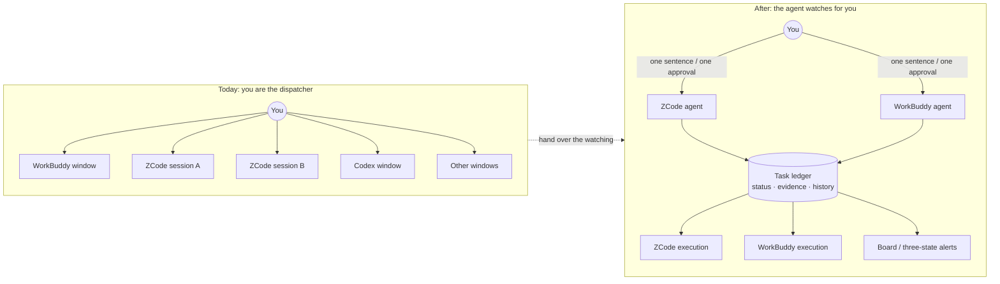
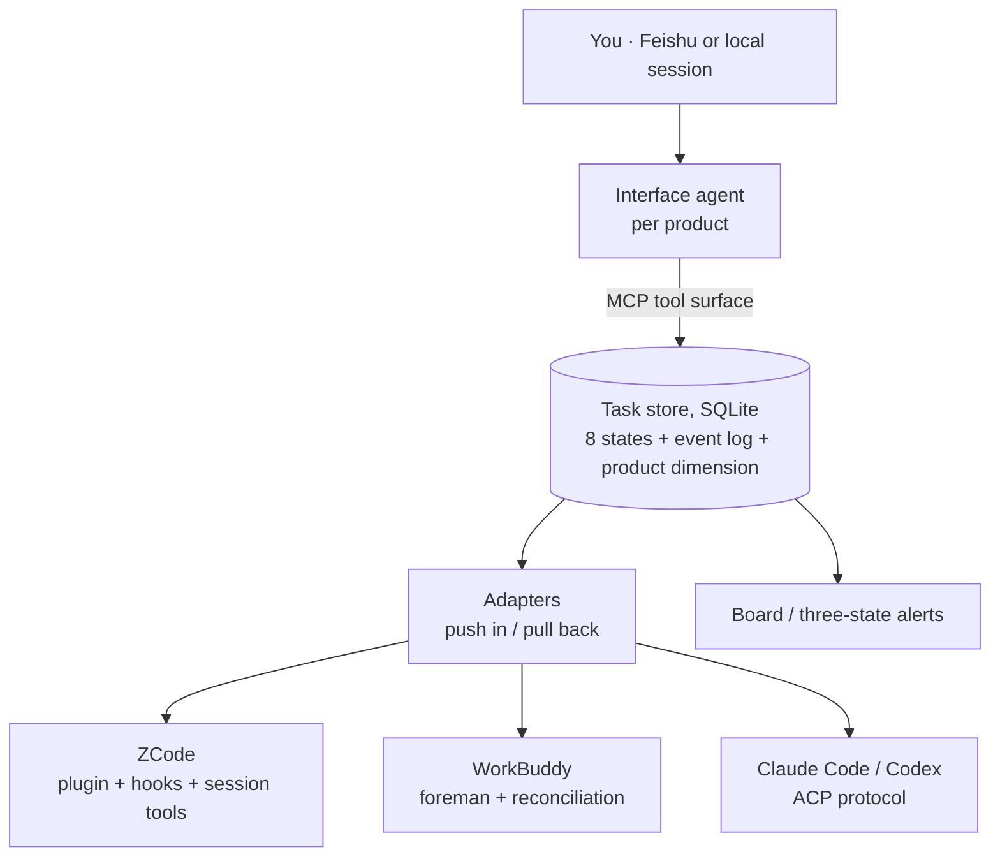

# VibeMission

> **One product, one interface agent.** ／ 一个产品，一个接口人。

English · [简体中文](README.md)

[](LICENSE)
[](#roadmap)
[](package.json)

VibeMission runs on your machine and gives **each AI coding product its own interface agent** — one that registers tasks, dispatches them, tracks progress, chases stalls, and closes them out. You talk to one agent per product instead of hopping between N chat windows. Interface agents on different machines can also **roll up into a single read-only view**.

---

## 1. The problem: the bottleneck is attention, not the model

Run a few agent tasks at once and *you* become the dispatcher: creating sessions, asking each one for status, unblocking stalls, remembering where every thread stands.

| Today | Consequence |
|---|---|
| 5 products = 5 windows | N threads held in your head at once |
| Asking "is it done?" over and over | Hours spent chasing status |
| An agent stuck on a permission prompt | You find out hours later, assuming it was working |
| Digging through chat logs for evidence | Proof scattered, disputes unanswerable |

Put bluntly: **a single task is bounded by model capability; parallel tasks are bounded by human attention.**

---

## 2. What it is

```
Before:                          After:

 You ─┬─> WorkBuddy window         You
      ├─> ZCode session A           │  talk to one interface agent
      ├─> ZCode session B           ▼
      ├─> Codex window         ┌──────────────┐
      └─> another window       │ Interface agent │ register · dispatch · chase · close
         (you watch them all)  └──────┬───────┘
                                     │ one ledger
                                     ▼
                            ┌──────────────────┐
                            │ Task store (local)│ status · evidence · history
                            └────────┬─────────┘
                                     │ push in / pull back
                     ┌───────────────┼───────────────┐
                     ▼               ▼               ▼
                  ZCode          WorkBuddy      Claude Code…
                     └──── execution stays inside each product ────┘
```

**Six principles**

1. **One product, one interface agent.** ZCode gets one, WorkBuddy gets one; they never manage each other's work. Each agent's context is narrow and deep — it only knows one product's temperament.
2. **Execution stays inside the product.** Vendors already invest heavily in harness, stability and tooling. VibeMission does not rebuild an execution engine.
3. **One ledger, not one per product.** The product is a field on a task, not a separate system.
4. **Multi-device roll-up, without overreach.** Interface agents across machines can be viewed together; commands are forwarded to the owning agent, the roll-up never dispatches directly.
5. **Interrupt only when it matters.** You are pinged for blocked, needs-your-decision, and ready-for-review — nothing else.
6. **Tracking, management and cleanup belong to the agent.** No status forms, no weekly reports, no manual archiving. You do two things: **state intent** and **approve**.

**What it is not**: not an execution engine, not a multi-agent framework, not a general project-management tool (Gantt/timesheets), and it does not dispatch across products.

---

## 3. Value at a glance



---

## 4. How one task flows

```
You say it → keep the raw words → fill the gaps → write the task card → optimize the prompt → dispatch
                                    │
                     ┌──────────────┼──────────────┐
                     ▼              ▼              ▼
              acceptance         risks        decision points
```

**You show up twice**: to hand it over, and to accept it (plus once more if a decision is needed).

**The task card** carries six things: goal, acceptance criteria, risks, pending decisions, evidence, status.

**Acceptance criteria must be observable:**

| ❌ | ✅ |
|---|---|
| "Feels smooth" | Home cover appears within 2s on iPhone 13 Safari; no blank frame when paging |
| "Share bug fixed" | Share link opens in WeChat with cover rendered; console has no errors |

**Hard rules**: no acceptance criteria, no dispatch; incomplete evidence, no review; **only a human can mark it done.**

---

## 5. One question, five answers

Ask "how is everything going" and the reply always has the same shape:

```
Conclusion: all healthy — 2 running, 1 blocked, 1 waiting on you
Waiting on you: at most 3 items, each with options and a recommendation
Blocked: why + who owns it + what would unblock it
Running: next step + ETA for each
Just finished: name + evidence link
```

Report only when something changed; otherwise say "same as last time". No scheduled progress spam — interrupt only when it matters.

---

## 6. Architecture



| Layer | Owner | Responsibility |
|---|---|---|
| Interface agent | VibeMission | Intent, registration, dispatch, chasing, cleanup, reporting |
| Task ledger | VibeMission | State machine, event log, idempotency, product dimension |
| Adapter | VibeMission (thin) | Push in / pull back; never executes |
| Execution | **Each product** | Harness, tools, sandbox, retries, delivery quality |

---

## 7. Roadmap

| # | Product | Integration | When |
|---|---|---|---|
| 1 | **ZCode** | Plugin + hooks + native session tools | v1.0 |
| 2 | WorkBuddy | Foreman role card + read-only reconciliation | after v1.0 |
| 3 | Multi-device roll-up | Read-only aggregation | later |
| 4 | Claude Code / Codex | ACP protocol | later |

**v1.0 gates**: single-product loop working · resumable follow-ups · acceptance rules enforced · alerts that actually reach you · seven days of real use.

---

## 8. Repository layout

```
vibe-mission/
├── adapters/
│   ├── zcode/vibemission/      ZCode plugin (first): manifest + task store + hooks + owner skill
│   └── workbuddy/taskpier/     WorkBuddy prototype: foreman card + read-only reconciliation
├── core/                       Canonical source: store / state-machine / tools / mcp-server (25 tests)
├── board/                      Local web board (server + page + snapshot export)
├── channels/feishu/            Three-state alert push (idempotent)
├── docs/                       Architecture, adapter contract, mission lifecycle, ACP, research
├── scripts/                    Plugin validation / core sync / release checks
└── marketplace.json            Local ZCode plugin marketplace entry
```

---

## 9. Quick start

```bash
git clone https://github.com/StarDust-AI-Labs/vibe-mission.git
cd vibe-mission

# tests (25 in core)
node --test core/test/*.test.mjs

# local board
node board/server.mjs        # http://127.0.0.1:3210

# validate plugin manifest
node scripts/validate-plugin.mjs   # expect: validate: PASS
```

**Install in ZCode**: Plugins → add local directory → pick `adapters/zcode` in this repo.

---

## 10. Docs

| Doc | Content |
|---|---|
| [Mission lifecycle & task card](docs/mission-lifecycle.md) | Three-level model, six-stage gates, card fields, acceptance wording, intake pipeline, reporting |
| [Adapter contract](docs/adapters.md) | Tier 0/1/2 capability ladder, ports, six-step onboarding |
| [adapter-acp](docs/adapter-acp.md) | Why a generic dispatch plug exists: translation only, capability declaration with graceful degradation |
| [Prior art](docs/research/2026-11-24-prior-art.md) | Comparison with AgentRQ / Vibe Kanban / Backlog.md and 7 more |
| [Reuse map](docs/research/2026-11-24-reuse-map.md) | Which OSS pieces to adopt, and license red lines |
| [Architecture](docs/architecture.md) · [Status model](docs/status-model.md) · [Decisions](docs/decisions.md) | Layers, 8-state lifecycle, key trade-offs |

---

## 11. License

[MIT](LICENSE) © StarDust AI Labs

> v1.0 is in development; interfaces and data shapes may still change. Issues discussing positioning and design are welcome.
