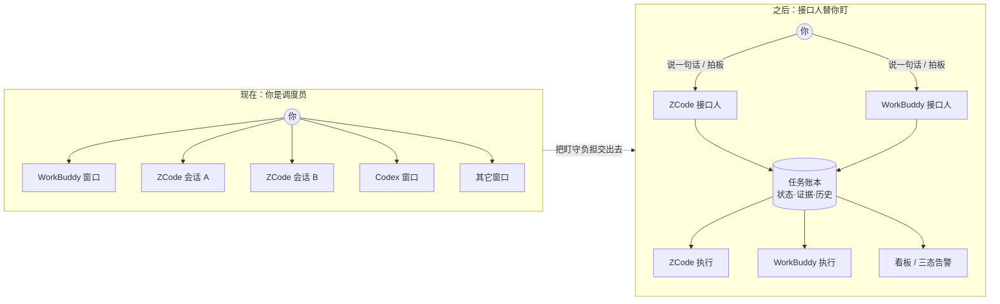
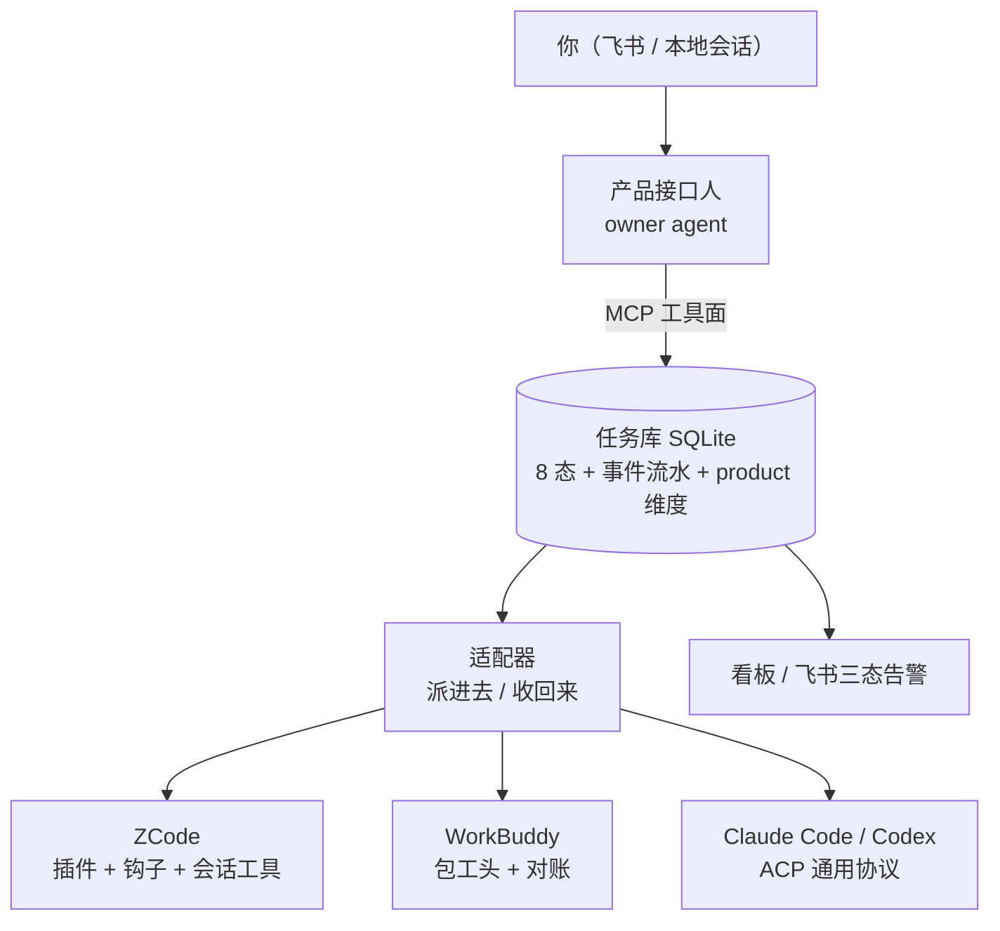

# VibeMission

> **一个产品，一个接口人。** ／ *One product, one interface agent.*

[English](README.en.md) · 简体中文

[](LICENSE)
[](#路线)
[](package.json)

VibeMission 跑在你本机：**每个 agent 产品配一位接口人**，替你登记、派工、盯进度、催办、收尾。你只跟当前产品的接口人说话，不再在 N 个对话框之间来回切换。多台设备上的接口人还能**汇总到一处看全**。

---

## 一、要解决的问题：瓶颈不在模型，在人的注意力

同时开几个 agent 任务，人就成了调度员：建会话、逐个问进度、处理卡死、记住每条线做到哪一步。任务越多，越不是模型不够用，而是**人脑里挂着的线程太多**。

| 现在 | 后果 |
|---|---|
| 5 个产品 = 5 个窗口 | N 条线要同时记在脑子里 |
| 挨个问"好了吗" | 大量时间花在追问上 |
| agent 卡在权限 / 等决策 | 几小时后你才知道，期间一直以为它在跑 |
| 验收翻聊天记录找截图 | 证据散落，争议时说不清 |

一句话：**单个任务的上限是模型能力，并行任务的上限是人的注意力。**

---

## 二、它是什么（定位）

```
先看问题：                      再看它：

 你 ─┬─> WorkBuddy 窗口           你
     ├─> ZCode 会话 A               │  只跟当前产品的接口人说话
     ├─> ZCode 会话 B               ▼
     ├─> Codex 窗口            ┌──────────────┐
     └─> 另一个窗口            │  产品接口人   │ 登记·派工·催办·收尾
        （你得盯住每一条）      └──────┬───────┘
                                     │ 一套账本
                                     ▼
                            ┌──────────────────┐
                            │ 任务库（本地）    │ 状态·证据·历史
                            └────────┬─────────┘
                                     │ 派进去 / 收回来
                     ┌───────────────┼───────────────┐
                     ▼               ▼               ▼
                  ZCode          WorkBuddy      Claude Code…
                     └────── 执行留在产品内部完成 ──────┘
```

**六条主张**

1. **一个产品，一个接口人。** ZCode 一位、WorkBuddy 一位，各管自己那一摊，不互相代管。负责人的上下文窄而深——只懂一个产品的脾气。
2. **执行留在产品内部。** 大厂 agent 产品在 harness、稳定性、工具链上各有真本事，任务就该在它们内部干完、交付。VibeMission 不重做执行引擎。
3. **一套账本，不按产品分裂。** 任务表只有一份，产品是任务上的一个字段；换产品不用换脑子。
4. **多设备可汇总，汇总不越权。** 多个设备上的接口人能汇到一处看全；下达时转给对应接口人，汇总层不直接派工。
5. **该打扰时才打扰。** 只在阻塞、待你决策、待验收三种状态找你，其余安静跟踪。
6. **跟踪、管理、清理全交给 agent。** 人不填状态、不写周报、不手动归档。人只做两件事：**下达意图**和**拍板**。

**它不是什么**：不是执行引擎，不是多 agent 框架，不是通用项目管理工具（甘特/工时），也不做跨产品派工。

---

## 三、价值示意图



---

## 四、一次任务怎么走

```
你说一句 → 留存原话 → 补齐澄清 → 写成任务卡 → 优化提示词 → 建会话执行
                                    │
                     ┌──────────────┼──────────────┐
                     ▼              ▼              ▼
                  验收标准        风险清单        待拍板点
```

**人只出场两次**：下达时一次，验收时一次（中途需要拍板才多一次）。

**任务卡六件事**：目标、验收标准、风险、待拍板点、证据、状态。

**验收标准必须可观察**：

| ❌ | ✅ |
|---|---|
| 体验流畅 | iPhone 13 Safari 首屏 2 秒内出现封面，翻页无白屏 |
| 修好了分享问题 | 微信内打开分享链接正常显示封面，控制台无报错 |

**硬规则**：没有验收标准不许派工；证据不齐不许进验收；**只有人能说"完成"**。

---

## 五、统一汇报

你问一句"进展怎么样"，回答固定五段：

```
结论：整体正常，2 件在跑，1 件卡住，1 件等你拍板
等你拍板：最多 3 条，带选项和建议
卡住的：原因 + 卡在谁那里 + 需要什么
在跑的：各自下一步 + 预计完成
刚完成：名称 + 证据链接
```

有变化才说；没变化就一句"和上次一样"。不主动发全量日报——该打扰才打扰。

---

## 六、架构



| 层 | 归谁 | 职责 |
|---|---|---|
| 接口人 | VibeMission | 意图理解、登记、派工、催办、清理、汇报 |
| 任务账本 | VibeMission | 状态机、事件流水、幂等、产品维度 |
| 适配器 | VibeMission（薄） | 派进去 / 收回来，不实现执行 |
| 执行 | **各 agent 产品** | harness、工具、沙箱、重试、交付质量 |

---

## 七、路线

| 顺序 | 产品 | 接入方式 | 时点 |
|---|---|---|---|
| 1 | **ZCode** | 插件 + 钩子 + 原生会话工具 | v1.0 首发 |
| 2 | WorkBuddy | 包工头岗位卡 + 只读对账 | 首发后 |
| 3 | 多设备汇总 | 只读看全 | 之后 |
| 4 | Claude Code / Codex | ACP 通用协议 | 更后 |

**v1.0 发布门槛**：单产品闭环跑通 · 隔天续做不断线 · 验收口径生效 · 打扰有效 · 七天真实使用。

---

## 八、仓库结构

```
vibe-mission/
├── adapters/
│   ├── zcode/vibemission/      ZCode 插件（首发）：插件清单 + 任务库 + 钩子 + 接口人技能
│   └── workbuddy/taskpier/     WorkBuddy 原型：包工头岗位卡 + 只读对账
├── core/                       规范源：store / state-machine / tools / mcp-server（25 个测试）
├── board/                      本地看板（server + page + 快照发布）
├── channels/feishu/            三态告警推送（幂等）
├── docs/                       架构、适配器契约、任务生命周期、ACP 设计、调研
├── scripts/                    插件校验 / core 同步 / 发布检查
└── marketplace.json            ZCode 本地插件市场入口
```

---

## 九、快速开始

```bash
git clone https://github.com/StarDust-AI-Labs/vibe-mission.git
cd vibe-mission

# 跑测试（core 25 项）
node --test core/test/*.test.mjs

# 起本地看板
node board/server.mjs        # http://127.0.0.1:3210

# 校验插件清单
node scripts/validate-plugin.mjs   # 期望 validate: PASS
```

**在 ZCode 里安装**：插件市场 → 添加本地目录 → 选仓库根的 `adapters/zcode`。

---

## 十、文档

| 文档 | 内容 |
|---|---|
| [Mission 生命周期与任务卡](docs/mission-lifecycle.md) | 三层模型、六阶段准入、任务卡字段、验收标准写法、立项流水线与统一汇报 |
| [适配器契约](docs/adapters.md) | Tier 0/1/2 能力阶梯、端口定义、新宿主接入六步 |
| [adapter-acp](docs/adapter-acp.md) | 通用派工插头的设计理念：只翻译不做业务、能力声明与降级 |
| [同类项目调研](docs/research/2026-11-24-prior-art.md) | AgentRQ / Vibe Kanban / Backlog.md 等 10 个项目对比 |
| [可复用实现清单](docs/research/2026-11-24-reuse-map.md) | 哪些开源件可直接用、许可证红线 |
| [架构](docs/architecture.md) · [状态模型](docs/status-model.md) · [决策日志](docs/decisions.md) | 分层、8 态生命周期、关键取舍 |

---

## 十一、许可

[MIT](LICENSE) © StarDust AI Labs

> 项目处于 v1.0 开发期，接口和数据结构仍可能变动。欢迎提 issue 讨论定位与实现。
